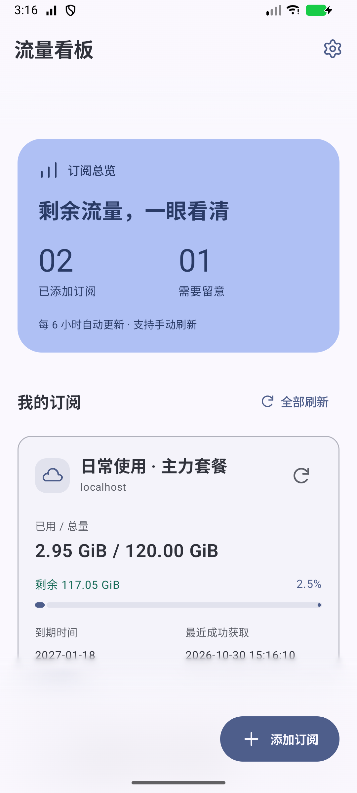
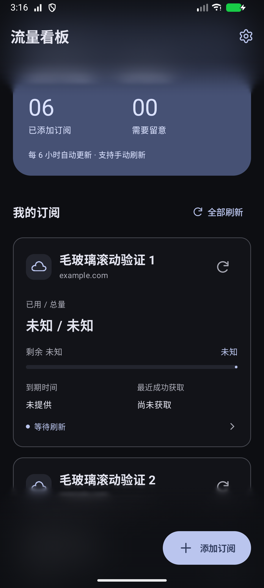
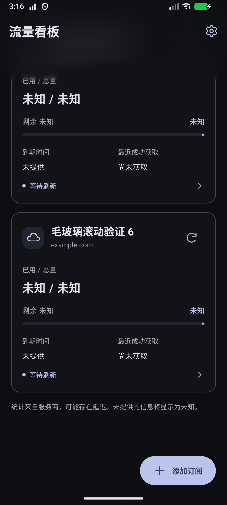

# 流量看板 · Android

独立查看 VPN 订阅套餐额度的原生安卓应用。支持 Android 8.0（API 26）及以上，不建立 VPN 连接，可与现有 VPN 客户端配合使用。

## 下载与安装

前往 [Releases 下载页面](https://github.com/Max1426/traffic-board/releases/latest)，下载 `TrafficBoard-1.1.2.apk` 安装；页面同时提供源码压缩包与 SHA-256 校验文件。手机如提示安装限制，需要允许当前浏览器或文件管理器安装应用。

当前版本 **1.1.2（versionCode 4）**，使用原签名，可直接覆盖旧版并保留订阅与设置。请使用 APK 文件安装；GitHub 的 “Source code” 压缩包需要自行编译。

## 界面预览

截图来自模拟器，订阅均为测试数据；正式版不预置订阅。

| 首页 | 顶栏连续毛玻璃 | 底栏连续毛玻璃 |
| --- | --- | --- |
|  |  |  |

## 功能

- Material 3 卡片首页：多订阅、已用／总量、剩余量、实际使用百分比、到期日和更新时间。
- 添加、重命名、编辑链接／User-Agent、删除、单独刷新与全部刷新。
- 详情页显示上传、下载和完整时间；订阅链接默认隐藏。
- 每六小时后台刷新，启动时补充刷新过期数据，联网后重试临时网络故障。
- 可修改的流量阈值和到期天数，默认 80%／95% 和 7／3 天；已到期也会提醒。
- 同一提醒阈值持久化去重；额度回落到阈值以下、到期日变化或新增阈值后可再次触发。未授权通知不会消耗提醒记录，应用内仍提示异常。

## 1.1.2 更新：连续毛玻璃与简洁齿轮

- 设置入口采用选定的 Lucide 简洁齿轮矢量图标，保持 24 dp 图形、原点击区域及触感。
- 修正背景画布记录与边缘采样，背景颜色完整参与模糊，避免状态栏后方的清晰文字透出。
- 使用 0、4、8、16、24、36、48 dp 高斯层，64 dp 内平滑恢复到原画面；相邻层权重归一合成，底色遮罩同步衰减。
- 按层裁剪有效区域并降低大半径采样分辨率，复用图层；Android 8–11 保留半透明渐变回退。
- 新增整段渐变像素检查与屏幕顶边防漏字检查。模拟器性能数据不代表实体手机帧率。

## 1.1.1 更新：上下栏毛玻璃

- 标题栏和首页底部操作栏覆盖于滚动内容上方，卡片滚入后方时柔和模糊，标题与按钮保持清晰。
- Android 12+ 使用 24 dp 背景模糊；交界处采用 20 dp 渐隐。浅色底色透明度约 65%，深色约 55%，随 Material 3 配色变化。
- Android 8–11 使用半透明与渐隐过渡；不进行截图轮询，不增加第三方依赖；模糊层以半分辨率采样，降低离屏像素开销。
- 列表首尾、详情与表单使用内部留白，首项和最后一项可完整滚动查看；栏位阻挡对后方卡片的误触。

## 1.1.0 更新：Material 3 与按键触感

- 全部页面使用 Material 3 语义配色、卡片、胶囊按钮、分段选择和开关，支持浅色、深色和跟随系统。
- Android 12 及以上默认使用壁纸动态配色，可在“设置 → 外观”关闭；Android 8–11 使用默认蓝色配色。
- “设置 → 触感反馈 → 按键震动”默认开启，可即时关闭。按钮、导航、卡片及开关使用轻量系统触感；保存与输入错误使用对应反馈。
- 反馈遵循手机的系统触感开关，不申请额外震动权限；无震动马达或系统关闭触感时仍可正常操作。后台刷新与通知不触发按键震动。
- 外观与触感设置即时加密保存，兼容 1.0.0 的本地数据。使用相同签名，可直接覆盖升级并保留订阅。

## 添加订阅

1. 点击右下角“添加订阅”，填写名称和服务商提供的 **HTTPS 订阅链接**。
2. 点击“保存并刷新”。如果服务商要求特定客户端标识，可展开高级设置修改 User-Agent。
3. 在“设置”中调整阈值，需要系统通知时点击“开启通知”。

统计读取自订阅响应的 `subscription-userinfo`，已用量为上传量加下载量。数值是服务商的统计快照，可能存在服务端延迟，也可能涵盖同账号的其他设备。应用不统计实时网速，不访问服务商账号密码，不运行代理内核。

缺失／无效字段显示未知；总量为零不解释成无限额度；超额时保留实际百分比并将进度条填满。失败时保留上次成功结果，显示旧数据标记；成功响应未提供统计头时则显示“服务商未提供统计信息”。流量采用 1024 进制并标注 GiB／MiB，时间使用手机时区。

后台调度受到 Android 和手机厂商省电策略影响，六小时并非精确闹钟；通知在成功刷新后判断。强制停止应用、关闭通知或限制后台运行会影响及时性。桌面组件、常驻通知、历史趋势和实时网速不包含在第一版。

## 本地数据

整个本地数据文件采用 AES-256-GCM 加密，密钥由 Android Keystore 管理，文件存放在 `noBackupFilesDir`。应用关闭系统备份，并排除云端备份与设备迁移，不记录订阅链接到日志，不配置分析或广告 SDK。卸载应用会移除本地订阅与密钥。

## 构建

需要 Java 21、Android SDK Platform 35 和联网下载 Maven 依赖。项目自带 Gradle Wrapper 9.3.0；不需要全局 Gradle。

在 PowerShell 7 中运行：

```powershell
.\scripts\build.ps1
# 已连接专用测试设备／模拟器时，可额外运行完整设备测试：
.\scripts\build.ps1 -DeviceTests
```

脚本会执行单元测试、Debug／Release lint 和 Release 构建，将正式签名安装包复制到 `dist/TrafficBoard-1.1.2.apk`，并生成 SHA-256。Android Studio 可直接打开项目。

只需开发或试运行时，可在 Android Studio 中运行 Debug，或执行以下命令，无需正式签名密钥：

```powershell
.\gradlew.bat :app:testDebugUnitTest :app:lintDebug :app:assembleDebug
```

macOS / Linux 可运行 `chmod +x gradlew`，然后使用 `./gradlew` 执行相同任务。自行构建的 Debug 或自行签名版本不能覆盖安装本项目发布的正式 APK。

首次构建自动在当前用户的 `.android/traffic-board-signing/` 中创建独立签名密钥和私有签名配置，目录限制为当前用户及 SYSTEM 可访问；这些文件不在项目和源码压缩包内。**保留此目录才能发布可覆盖安装的后续版本**，请妥善私下备份，不要公开分享签名配置。

中文 Windows 路径可能导致 Gradle 测试工作进程无法加载类，本项目会把编译后的单元测试类临时同步到系统临时目录，再执行测试；源码与测试报告仍保留在项目内。

设备测试使用本机模拟订阅服务和虚构链接，只存在于 `androidTest` 中。Debug 构建允许本机回环 HTTP 地址用于测试；正式 Release 构建只接受 HTTPS，不附带示例订阅。设备测试会重置**本应用**的本地测试订阅并测试通知权限，请只对专用测试设备运行。

## 结构与验证

- `model`：订阅数据、统计解析、单位显示和提醒判断。
- `data`：加密存储、HTTP 请求、并发刷新与状态持久化。
- `ui`：Compose 页面、Material 3 主题、系统触感反馈和自绘图标。
- `TrafficApplication`：六小时后台任务和系统通知。
- `app/src/test`：统计边界、真实模拟 HTTP、状态恢复、提醒与并发测试。
- `app/src/androidTest`：完整 UI 流程、Keystore 文件、通知去重及布局检查。
- `verification`：验证记录和模拟器截图；截图中的订阅均为测试数据。

协议参考：[Clash Verge Rev 订阅响应头](https://www.clashverge.dev/guide/url_schemes.html)、[Android WorkManager 调度](https://developer.android.com/develop/background-work/background-tasks/persistent/getting-started/define-work)。

触感实现参考：[Android 系统触感接口](https://developer.android.com/develop/ui/views/haptics/haptics-apis)；主题参考：[Compose Material 3](https://developer.android.com/develop/ui/compose/designsystems/material3)。

## 验证与反馈

1.1.2 已通过 47 项单元测试、普通屏幕和小屏大字体下共 14 个设备测试结果，Debug / Release lint 均无错误。覆盖升级验证保留了订阅和修改后的设置。详见 [验证记录](verification/验证结果.md)。

软件渲染模拟器中，新版渐变模糊的帧耗时高于 1.1.1；尚未进行实机性能、实体触感和真实服务商订阅兼容性验证。Android 8–11 的回退路径已在模拟器中强制测试，尚无旧系统实机测试结果。

欢迎通过 Issues 反馈。请提供手机型号、Android 版本、应用版本和复现步骤；截图中请隐藏完整订阅链接、令牌等个人信息。

## 开源许可

项目采用 [MIT License](LICENSE)，允许使用、修改和分发。第三方图标与组件说明见 [THIRD_PARTY_NOTICES.md](THIRD_PARTY_NOTICES.md)。
